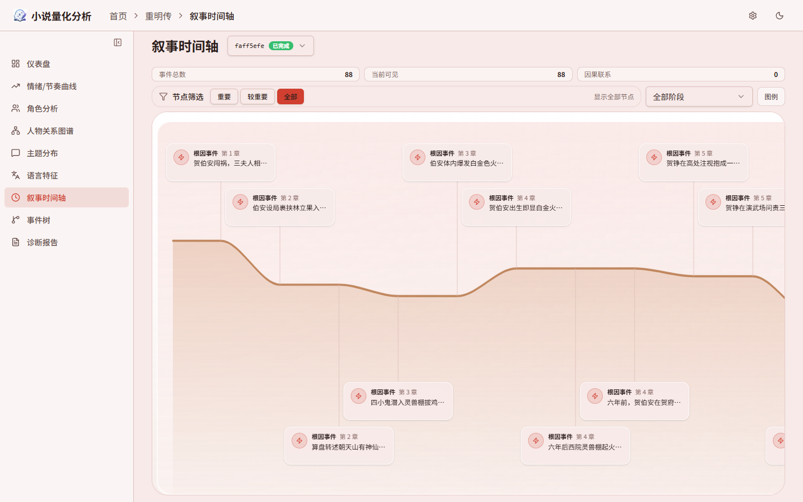
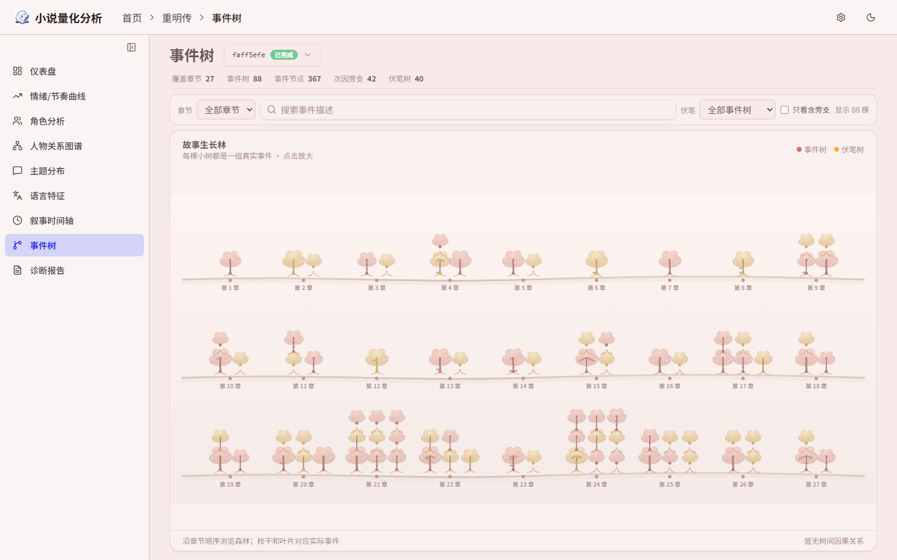
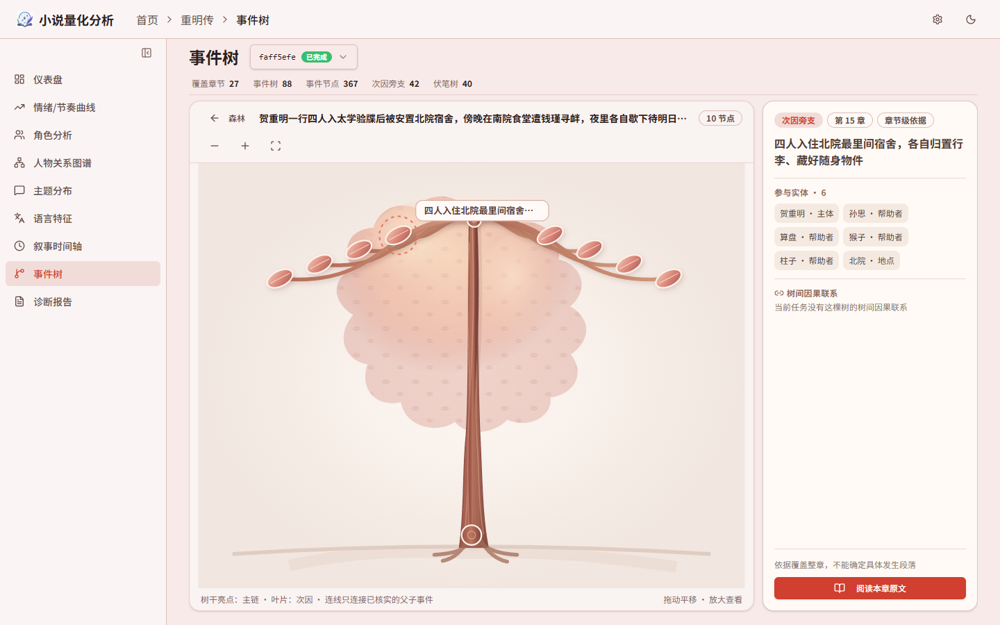

# NovelIQ

> [English](README_EN.md)


[](LICENSE)

对中文网络小说做量化分析的平台：上传一本 txt 全本，六阶段流水线自动完成全书分析。LLM 逐章标注人物、对话、关系、事件与伏笔，配合本地语言模型产出多维指标，最终汇成一组可视化视图与诊断报告。分析在后台运行、逐阶段落库，中断或取消后可从断点继续。

分析完成后，前端提供：

- **情感 / 节奏曲线**：段落级情感打分与叙事节奏指标，全书曲线，窗口可切换
- **人物关系图谱**：标注 Agent 逐章记录人物、对话与关系，跨章合并成网络，力导向图浏览
- **事件时间线**：情节事件沿时间轴呈现
- **事件树**：按章节范围查看完整事件、包含关系、原因与结果，并展开原文依据
- **主题分布**：LDA 主题建模，检测主题随情节的转移
- **语言特征**：LTP 词法句法分析、词汇丰富度（TTR/MTLD）、对话比例等
- **诊断报告**：LLM 基于全书取证生成质量评估，可导出为单文件 HTML

| 情绪/节奏曲线 | 人物关系图谱 |
| --- | --- |
|  |  |
| **叙事时间轴** | **仪表盘** |
|  |  |

| 事件森林 | 树内因果结构 |
| --- | --- |
|  |  |

从 0.2.1 升级请先阅读 [0.3.0 升级说明](docs/upgrades/UPGRADE-0.3.0.md)：入口默认只读预检，执行转换需要备份、隔离演练和显式指定数据库。此次发布提供一次旧数据转换例外；需要重新分析的结果仍由正式流程从原始输入生成。历史迁移脚本仅适用于各自对应的发布代码。

技术栈：Python 3.12 / FastAPI / SQLAlchemy / PostgreSQL 17（pgvector）；React 19 / Vite / ECharts / Tailwind CSS。LLM 走 OpenAI 兼容接口（自建服务或第三方 API 均可），词法分析与词向量为本地离线模型。

## 快速开始

### 前置：离线模型

LTP 与 Word2Vec 从本地加载，**不会自动联网下载**，均可经设置启停：

- **LTP**（`linguistic.ltp.enabled`，默认开启）：完整离线模型目录，路径经 `LTP_MODEL_DIR` 环境变量配置。开启但模型缺失时，分析在「语言结构」阶段报错；关闭则跳过词法/句法/语义标注
- **Word2Vec**（`linguistic.word2vec.enabled`，默认关闭）：关闭时无需模型；开启后需 `models/word2vec/shared/` 下的转换 `.kv` 主文件（依赖 LTP 词元），缺失同样在「语言结构」阶段报错。已有 `.vec`/`.bin`/`.txt` 预训练向量时执行：

  ```powershell
  uv run python -m scripts.convert_word2vec_pretrained
  ```

  默认从 `models/word2vec/pretrained/` 读取，写入 `models/word2vec/shared/`。

`models/` 不进 Git；Docker Compose 会把宿主机该目录挂载到容器 `/app/models`。

### Docker 部署（推荐）

```powershell
Copy-Item .env.docker.example .env.docker   # 填入模型 API 密钥
docker compose up -d --build
```

`.env.docker` 的数据库已预置指向 Compose 内置的 Postgres，需要填的只有文本模型（`MODEL_*`）和 Embedding 服务地址；模型目录从宿主机 `./models` 挂载。

- 前端：<http://localhost:18080>
- API 文档：<http://localhost:18080/api/docs>

### 源码运行

需要本地 PostgreSQL 17（含 pgvector 扩展）。

```powershell
./scripts/dev.ps1 setup        # 安装依赖（uv）
Copy-Item .env.example .env    # 填数据库与模型 API 密钥
./scripts/dev.ps1 api --port 8000   # 空库初始化；已有结构须与当前模型一致
```

前端另开终端：

```powershell
cd frontend
npm install
npm run dev                    # http://localhost:5173，/api 代理到后端 8000
```

## 系统分层

| 层 | 目录 | 职责 |
| --- | --- | --- |
| API | `src/api/routes`、`src/api/services` | HTTP 接口、结果查询、视图数据与 HTML 导出 |
| 工作流 | `src/workflows` | 任务生命周期、六阶段编排、恢复与取消 |
| Agent 与领域 | `src/agents`、`src/diagnosis`、`src/fact_graph`、`src/event_trees`、`src/case_pool` | 标注与诊断、事实图、完整事件与案例办理 |
| 量化分析 | `src/metrics`、`src/linguistic`、`src/topic`、`src/lexicons`、`src/text_processing` | 指标、语言结构、主题、词表与文本处理 |
| 执行与通知 | `src/work`、`src/model_pool`、`src/audit`、`src/event_bus`、`src/sse` | 工作调度、模型容量与健康分、审计、通知持久化与回放 |
| 存储 | `src/storage` | 30 张业务表、UUIDv7 主键、具名读写接口、事务与领域约束 |

任务请求经 API 进入工作流应用服务和阶段编排，由 Agent 与领域模块处理，再经 Storage 保存结果。活动通知统一经过 EventBus，SSE 消费者先持久化再推送，支持游标回放；前端分析工作台展示真实 Agent 执行与模型通信。

项目发布版本只维护在 `pyproject.toml`，健康接口与 OpenAPI 共用这一来源。图与事件树按真实章节身份和章节顺序读取，全书结果按运行身份独立保存。界面仅面向桌面端，时间线与事件树分别维护交互状态。

## 分析流水线


| 阶段 | 入口 | 机制与产出 |
| --- | --- | --- |
| 预处理 | `run_preprocess` | 编码探测、章节切分、章节与段落落库、向量嵌入；后续阶段共享原始段落边界 |
| 标注 | `run_annotate` | 章节工作池调度 annotation 或 entity / event / metric 角色，提取实体、关系、对话、完整事件、伏笔与指标；结束请求仍须通过完整性检查和保存确认 |
| 语言结构 | `run_linguistic` | LTP 词元、依存与语义依存、短语命中和情绪事件；按设置启用 Word2Vec |
| 聚合 | `run_aggregate` | 汇总段落指标、情绪与节奏曲线、全局统计及质量检查 |
| 主题建模 | `run_topic_model` | LDA 训练与模型持久化，运行保存完成事实，`lda_paragraph_topics` 保存段落主题分布 |
| 诊断 | `run_diagnose` | 按诊断角色取证、办理案例并生成报告，工作调度受模型池实际容量约束 |

**恢复与取消**：数据库保存任务状态与各阶段完成事实；续跑保留已保存的标注角色结果。取消、失败与重试沿工作流处理，工作台展示失败摘要、重试和未执行状态。

**并发与程序面**：标注按章节体量选择单角色或 entity / event / metric 职责工作，实际并发由模型池容量决定。模型通过 `execute_code(code)` 在受限解释器中批量读写，变量跨程序保留；程序面复用原工具校验，拒绝 import、文件与网络访问。模型设置支持上下文容量，达到压缩条件时整理会话历史。

## 量化方法

- **曲线与平滑** —— 情绪/节奏曲线以字符坐标为轴，平滑用 robust LOWESS：tricube 核加权局部线性回归，bisquare 稳健迭代三轮抑制离群段，窗口点数不足时带宽自适应倍增；平滑锚定段落打分的字符位置（段长作样本权重）。
- **情绪标尺按书拟合** —— 段落情绪强度由情感词典直接打分（否定词处理为共享计算层，句界内生效）；标注 Agent 逐章自选情绪段作监督，全书段落向量现拟合线性边界后逐段回写分值。监督不足（标签 <2 或全同分值）时留空不伪造，且跨书口径不同、曲线不可比。
- **主题与转移** —— gensim LDA 保存模型产物与段落主题分布，保留各主题权重；主题转移取相邻窗口分布的 Jensen-Shannon 散度。
- **叙事阶段与张力** —— 全局峰/局部峰检测把全书划成引入/发展/高潮/收束四段；张力代理指标（战斗词模糊匹配密度、感叹/问句密度、对话比、平均句长）逐段统计。

## 事实图与案例

标注 Agent 在运行级共享事实图中登记实体、关系、对话和事实。实体引用使用正文名字与大类，读取支持关键词检索、字段投影及分页。领域贡献按真实生产 Agent 保存；失败和恢复沿既有贡献、保存确认与回滚链处理。

案例统一进入案例池，保留明确的 `caseid`，通过 `claim_case`、`submit_case` 和放弃操作办理。一个会话可持有多个案例，领取只约束案例办理，不构成事件级锁。案例保存登记与解决状态，业务结果按其实际生产者独立保存。

## 事件树

`event_records` 保存完整事件的标题、问题、概要、类型、状态、章节起止和真实生产者；参与者与原文证据单独保存。标注和诊断共用正式事件身份，章级读取按实际章节边界组织结果，跨章结果保持原有证据来源。

包含关系、语义关联、情节线与结果组织通过正式领域入口生成和读取。桌面事件树以事件卡片和关系曲线展示相关事件，可查看详情与原文；时间线独立展示情节顺序。

初始化先只读检查已有表、字段、类型、键和约束，不兼容结构会被拒绝。常规数据纠错从原始输入重新生成；本次发布的旧库转换范围、归档与重新分析要求见 [0.3.0 升级说明](docs/upgrades/UPGRADE-0.3.0.md)。

## 审计与通知

| 表 | 粒度 | 内容 |
| --- | --- | --- |
| `agent` | 一次真实 Agent 执行 | 运行归属、角色与执行状态 |
| `agent_loop` | 一次真实模型请求 | Agent 回合或独立调用身份、模型、用量、费用、计时与通信文档 |
| `agent_toolcall` | 一次工具调用 | 参数、实际执行参数、响应、回执、错误和耗时 |
| `agent_outbox` | 一条活动通知 | 幂等键、运行与章节路由、实际消息字节和投递时间 |

供应商实报用量与程序估算分别记录。请求、响应和回执文档用于审计与展示；工作台通过持久化通知和回放还原执行过程。

## 许可证

[Apache-2.0](LICENSE)。
