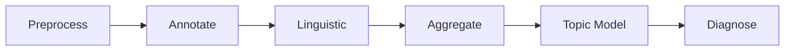

# NovelIQ

> [中文文档](README.md)


[](LICENSE)

A quantitative analysis platform for Chinese web novels: upload a full `.txt` book and a six-stage pipeline analyzes it end to end. An LLM annotates characters, dialogue, relations, events and foreshadowing chapter by chapter, local language models produce multi-dimensional metrics, and everything converges into a set of visual views and a diagnostic report. Analysis runs in the background with each stage persisted as it completes, so interrupted or cancelled runs resume from where they stopped.

Once analysis completes, the frontend provides:

- **Sentiment / pacing curves**: paragraph-level sentiment scoring and narrative pacing metrics, whole-book curves with switchable windows
- **Character relationship graph**: annotation agents record characters, dialogue and relations chapter by chapter, merged across chapters into a network browsed as a force-directed graph
- **Event timeline**: plot events presented along a timeline
- **Event trees**: inspect complete events, containment, causes and outcomes within a chapter range, with source evidence
- **Topic distribution**: LDA topic modeling that detects topic shifts across the plot
- **Linguistic features**: LTP lexical and syntactic analysis, lexical richness (TTR/MTLD), dialogue ratio, and more
- **Diagnostic report**: an LLM quality assessment grounded in whole-book evidence, exportable as a single-file HTML

| Sentiment / pacing curves | Character relationship graph |
| --- | --- |
|  |  |
| **Narrative timeline** | **Dashboard** |
|  |  |

| Event forest | Causal structure within a tree |
| --- | --- |
|  |  |

Read the [0.3.0 upgrade guide](docs/upgrades/UPGRADE-0.3.0.md) before upgrading from 0.2.1. The entry point defaults to read-only preflight; conversion requires a backup, an isolated rehearsal and an explicit database name. This release includes a legacy-conversion exception. Results requiring reanalysis still come from original input through the formal pipeline. Historical migration scripts apply only to their matching release checkout.

Stack: Python 3.12 / FastAPI / SQLAlchemy / PostgreSQL 17 (pgvector); React 19 / Vite / ECharts / Tailwind CSS. LLMs go through an OpenAI-compatible interface (self-hosted or third-party, both work); lexical analysis and word vectors are local offline models.

## Quick Start

### Prerequisites: offline models

LTP and Word2Vec load from local files and **never download over the network**; both can be toggled in settings:

- **LTP** (`linguistic.ltp.enabled`, on by default): a complete offline model directory, path configured via the `LTP_MODEL_DIR` environment variable. If enabled but the model is missing, analysis errors out at the Linguistic Analysis stage; when disabled, lexical/syntactic/semantic annotation is skipped
- **Word2Vec** (`linguistic.word2vec.enabled`, off by default): no model needed while off; once enabled it requires the converted `.kv` main file under `models/word2vec/shared/` (depends on LTP tokens), and a missing file errors at the same stage. For existing `.vec`/`.bin`/`.txt` pretrained vectors, run:

  ```powershell
  uv run python -m scripts.convert_word2vec_pretrained
  ```

  Reads from `models/word2vec/pretrained/` by default and writes to `models/word2vec/shared/`.

The `models/` directory is not tracked by Git; Docker Compose mounts the host directory into the container at `/app/models`.

### Docker deployment (recommended)

```powershell
Copy-Item .env.docker.example .env.docker   # fill in the model API keys
docker compose up -d --build
```

The database settings in `.env.docker` come preset to the Compose-bundled Postgres; the only things to fill in are the text model (`MODEL_*`) and the embedding service address. The model directory is mounted from the host `./models`.

- Frontend: <http://localhost:18080>
- API docs: <http://localhost:18080/api/docs>

### Run from source

Requires a local PostgreSQL 17 with the pgvector extension.

```powershell
./scripts/dev.ps1 setup        # install dependencies (uv)
Copy-Item .env.example .env    # fill in database and model API keys
./scripts/dev.ps1 api --port 8000   # initializes empty storage; existing structures must match the current models
```

Frontend in another terminal:

```powershell
cd frontend
npm install
npm run dev                    # http://localhost:5173, /api proxied to backend port 8000
```

## System Layers

| Layer | Directory | Responsibility |
| --- | --- | --- |
| API | `src/api/routes`, `src/api/services` | HTTP endpoints, result queries, view data and HTML export |
| Workflows | `src/workflows` | Task lifecycle, six-stage orchestration, recovery and cancellation |
| Agents and domains | `src/agents`, `src/diagnosis`, `src/fact_graph`, `src/event_trees`, `src/case_pool` | Annotation, diagnosis, fact graphs, complete events and cases |
| Quantitative analysis | `src/metrics`, `src/linguistic`, `src/topic`, `src/lexicons`, `src/text_processing` | Metrics, linguistic structure, topics, lexicons and text processing |
| Execution and notifications | `src/work`, `src/model_pool`, `src/audit`, `src/event_bus`, `src/sse` | Work scheduling, model capacity and health scores, audit, persisted notifications and replay |
| Storage | `src/storage` | 30 business tables, UUIDv7 primary keys, named read/write interfaces, transactions and domain constraints |

Task requests enter workflow application services through the API. Stage orchestration calls agents and domains, and Storage persists their results. Activity notifications pass through EventBus; the SSE consumer persists them before delivery and supports cursor replay. The analysis workstation displays actual agent executions and model communication.

The project release version is maintained only in `pyproject.toml`; health responses and OpenAPI read the same source. Graphs and event trees use real chapter identities and ordering, and whole-book results are isolated by run. The interface targets desktop use; the timeline and event tree keep independent interaction state.

## Analysis Pipeline



| Stage | Entry point | Processing and output |
| --- | --- | --- |
| Preprocess | `run_preprocess` | Encoding detection, chapter splitting, chapter and paragraph storage, and embeddings; later stages share the original paragraph boundaries |
| Annotate | `run_annotate` | The chapter work pool schedules annotation or entity / event / metric roles to extract entities, relations, dialogue, complete events, foreshadowing and metrics; finish requests still require completeness checks and save confirmation |
| Linguistic | `run_linguistic` | LTP tokens, dependency and semantic dependency arcs, phrase matches and emotion events; Word2Vec runs when enabled |
| Aggregate | `run_aggregate` | Paragraph metrics, sentiment and pacing curves, global statistics and quality checks |
| Topic model | `run_topic_model` | LDA training and model persistence; the run stores completion facts and `lda_paragraph_topics` stores paragraph topic distributions |
| Diagnose | `run_diagnose` | Diagnosis roles gather evidence, handle cases and produce reports, with concurrency bounded by actual model-pool capacity |

**Recovery and cancellation**: the database stores task states and stage completion facts. Resuming preserves saved annotation-role results. Workflows handle cancellation, failures and retries, and the workstation shows failure summaries, retries and work that did not execute.

**Concurrency and programs**: chapter size determines single-role or entity / event / metric work; actual concurrency follows model-pool capacity. Models batch reads and writes through `execute_code(code)` in a restricted interpreter with variables retained between programs. Programs reuse the original tool validation and reject imports, file access and network access. Model settings include context capacity, with conversation compaction when its conditions are met.

## Quantitative Methods

- **Curves and smoothing** — Sentiment/pacing curves are plotted on character coordinates; smoothing uses robust LOWESS: tricube-kernel weighted local linear regression, three bisquare robust iterations to suppress outlier segments, and bandwidth doubling adaptively when a window lacks enough points. Smoothing anchors to the character positions of paragraph scores (paragraph length as sample weight).
- **Per-book emotion calibration** — Paragraph emotion intensity is scored directly by the sentiment lexicon (negation handled as a shared computation layer, effective within sentence boundaries); the annotation agent picks emotion-bearing paragraphs per chapter as supervision, paragraph vectors across the book fit a linear boundary, and scores are written back per paragraph. With insufficient supervision (fewer than 2 labels, or all identical scores) the field stays empty rather than fabricated; and because each book fits its own scale, curves are not comparable across books.
- **Topics and shifts** — gensim LDA persists model artifacts and paragraph topic distributions with their full weights; topic shifts use Jensen-Shannon divergence between adjacent windows.
- **Narrative phases and tension** — Global/local peak detection divides the book into setup / development / climax / resolution; tension proxies (fuzzy-match density of combat words, exclamation/question density, dialogue ratio, average sentence length) are computed per phase.

## Fact Graph and Cases

Annotation agents register entities, relations, dialogue and facts in a shared graph scoped to the run. Entity references use source-text names and categories; reads support keyword search, field projection and pagination. Contributions retain their actual producing agent, with the existing save-confirmation and rollback chain handling failure and recovery.

Cases enter one pool with explicit `caseid` values and are handled through `claim_case`, `submit_case` and abandonment. A session can hold multiple cases. Claiming governs case handling and does not lock an event. Cases store registration and resolution state; business results retain their actual producer independently.

## Event Tree

`event_records` stores complete-event titles, problems, summaries, types, states, chapter ranges and actual producers. Participants and source evidence are stored separately. Annotation and diagnosis share formal event identities. Chapter reads use actual chapter boundaries, while cross-chapter results retain their source evidence.

Containment, semantic links, plotlines and outcome organization use the formal domain interfaces. The desktop event tree displays related events as cards and relationship curves with detail and source-text inspection. The timeline independently presents plot order.

Initialization first checks existing tables, fields, types, keys and constraints without modifying them; incompatible structures are rejected. Routine data corrections regenerate results from original input. See the [0.3.0 upgrade guide](docs/upgrades/UPGRADE-0.3.0.md) for this release's legacy conversion scope, archives and reanalysis requirements.

## Audit and Notifications

| Table | Granularity | Content |
| --- | --- | --- |
| `agent` | One actual agent execution | Run ownership, role and execution state |
| `agent_loop` | One actual model request | Agent round or standalone-call identity, model, usage, cost, timing and communication documents |
| `agent_toolcall` | One tool call | Arguments, executed arguments, response, receipt, error and duration |
| `agent_outbox` | One activity notification | Idempotency key, run and chapter routing, actual message bytes and delivery time |

Provider-reported usage and program estimates are recorded separately. Request, response and receipt documents support audit and display; the workstation reconstructs execution through persisted notifications and replay.

## License

[Apache-2.0](LICENSE).
