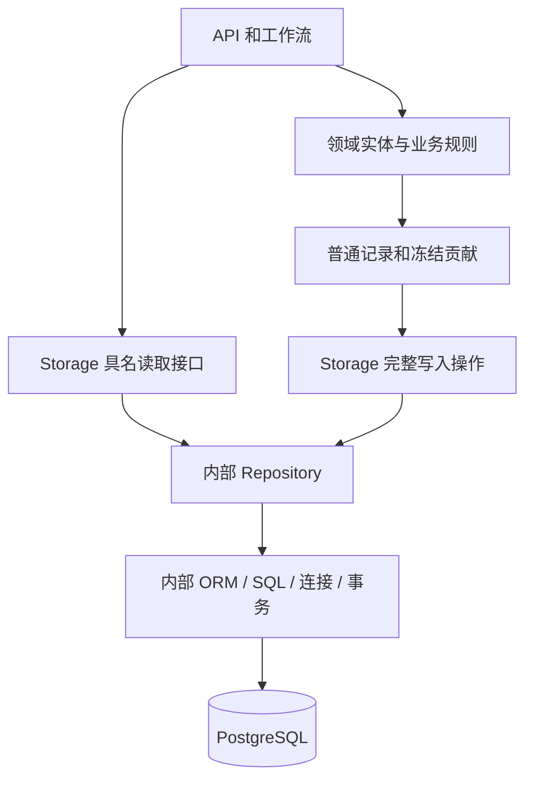

# Storage 接口封装与 Repository 维护方案

> 更新：2026-10-18
> 状态：已在独立工作树实施，正在完成回归验收，尚未合并或切换运行程序

## 1. 已确认的目标

Storage 对外提供明确的数据接口，在包内维护 Repository、ORM、SQL、连接和事务。业务实体及规则仍由所属领域定义，Storage 定义普通读写记录并维护持久化映射。

| 事项 | 确认结果 |
|---|---|
| 事务归属 | 完全由 Storage 负责，包括提交、回滚、锁和内部保存点 |
| 调用方式 | 业务提交冻结的普通数据，调用具名的完整保存操作 |
| 数据边界 | 不向业务公开 ORM、Session、连接、SQL 表达式、Row、Result、回调或事务上下文 |
| 主键格式 | 所有 35 张表使用单列 UUIDv7 主键，由 Storage 分配 |
| task 身份 | 保留独立的 8 位十六进制短 ID，通过唯一字段精确映射到 run_id |
| 原联合主键 | 新增独立主键，原业务字段保留唯一约束和外键关系 |
| 实施基线 | 承接原工作区源码快照，在独立工作树实现 |
| 分工 | 主代理实现，子代理只读审查 |
| 数据处理 | 只支持从原始输入建立新结构和新运行，不迁移或转换旧结果 |

本次保持 35 张表，不扩展业务角色或工作单元，不改变程序、构造器和子代理的正式调用关系。前端继续仅面向桌面端。

## 2. 工作树和保护边界

- 原目录：`D:\projects\python-projects\novel quantitative analysis`
- 实施工作树：`C:\Users\32891\.codex\worktrees\storage-interface\novel quantitative analysis`
- 分支：`codex/storage-interface`
- 起始 HEAD：`486c0cbf7cfda1fcb20bec867b504e6ef93f36eb`
- 工作区快照补丁：工作树父目录的 `source-baseline.patch`
- 补丁 SHA256：`9623C529A49E0843FD0D1C65756DE58CD7085DE4BDD87E0AA95A7BA7B28ED35C`

工作树包含承接的未提交改动，不能把全部 `git diff` 都认定为本次 Storage 改动。比对时使用冻结的源码快照区分基线与新增改动。

原目录、运行中的进程、原始输入和旧运行记录均保留。本次尚未提交、推送、合并、切换服务或运行模型重建。PostgreSQL 验证只在独立测试数据库中新建随机 schema，结束后仅清理测试创建的 schema。

## 3. 领域与 Storage 的职责

| 所属 | 负责内容 |
|---|---|
| `fact_graph` | 实体语义、名称归一化、关系方向、事实折叠及领域投影 |
| `event_trees` | 声明、事件、阶段及叙事组织规则，证据与业务终态校验 |
| `case_pool` | 案例登记、办理状态、贡献冻结和保存后的内存确认 |
| `linguistic` | 语言结构、否定与情绪等领域算法及语义聚合 |
| agents / work / workflows | 调度、程序执行、冻结贡献、调用完整保存操作、核验保存回执 |
| Storage | 普通记录、物理映射、具名查询、Repository、锁、外键刷新顺序和完整事务 |

Storage 的依赖底层限于配置与工具，不反向调用业务模块。不新增通用 `core/common/services` 层。

## 4. 公开接口与普通记录

公开入口为 `Storage`、`get_storage()`、`get_storage_factory()`、`new_id()` 和普通错误类型。业务获取的是无活动事务的能力入口，每次操作由 Storage 内部获取并释放连接。

按现有需求提供 `runs`、`novels`、`chapters`、`paragraphs`、`annotations`、`graph`、`narrative`、`cases`、`diagnosis`、`statistics`、`linguistic`、`forest`、`audit`、`sse` 等能力。生命周期提供初始化、健康检查、向量结构准备与校验、连接池统计及关闭。

读取接口返回普通 dataclass、具名记录、字典、列表或标量。数据库记录按属性或字段名访问；`NamedRecord` 禁止数字下标。嵌套 ORM 会在事务结束前递归转换，返回对象在连接关闭后仍可使用，嵌套可变容器与内部状态分离。

输入边界递归复制普通数据，拒绝 Session、Engine、Connection、ORM、SQL 表达式、数据库结果、函数和其他运行时对象。公开接口不提供任意表名、任意 SQL、属性透传或可执行查询 DSL。

## 5. Storage 内部事务规则

内部 `OperationRunner` 执行一个具名完整操作：取得连接、执行、刷新写入、转换普通结果、提交或结束只读事务，最后释放连接。操作失败先回滚，再释放连接。

PostgreSQL 读取操作使用只读事务。写入结果只能在提交成功后返回；提交响应异常不能直接当作“未保存”。业务通过独立读取核验正式产物，不能接管回滚。回滚失败必须保留为未知保存状态，不能据此重放模型调用。

| 完整操作 | 同一事务中的范围 |
|---|---|
| `annotations.save` | 标注头、事实、实体引用、声明、参与者与证据、对话、评估标签、案例交付及告警 |
| `annotations.consolidate` | 锁定并复核来源、章末程序凭据、事实回执及案例 |
| `annotations.discard_chapters` | 正式恢复链中整章贡献与回执的清退、引用顺序处理及事实重建 |
| `diagnosis.publish` | 正式报告、评估、完整事件、阶段、叙事组织、事实与对话归因、案例采纳及告警 |
| `paragraphs.save_topics` | 主题模型元信息、推断状态及完整主题分布 |
| `paragraphs.save_metrics` | 同批段落指标、张力及分类观测 |
| 审计与 SSE 操作 | 每次具名记录操作使用独立短事务 |

可选案例交付使用 Storage 内部保存点。允许局部失败时，失败信息随正式产物提交；网络故障等无法确认保存结果的错误不能降为普通业务告警。

标注重投读取原正式记录及已持久化告警。诊断告警按报告和真实执行归属保存；多个执行者的告警序号互不冲突。报告已提交但响应丢失时，重投先核验原报告和冻结快照，再恢复各执行者的告警，最后确认内存贡献。

## 6. UUIDv7、独立主键与外键

UUIDv7 是最终确定的格式，不采用 64 位 Snowflake 整数。生成器使用毫秒时间戳和随机段，同进程递增处理同毫秒分配，并处理时钟回退与 fork 状态。

全部 35 张表的主键均为单列 UUID，默认由 Storage 的生成器分配。所有 UUID 主键和 UUID 引用在写入及按身份查询时校验 UUIDv7。task 短 ID 是 `analysis_runs.task_id` 的独立唯一业务字段，不是第二个主键，也不从 run_id 的时间前缀截取。

| 表 | 独立主键 | 原业务字段约束 |
|---|---|---|
| `chapters` | 新增 `id` | `UNIQUE(run_id, chapter_id)`，另保留运行内章节顺序唯一性 |
| `paragraphs` | 新增 `id` | `UNIQUE(run_id, paragraph_id)`，保留章节内段落定位约束 |
| `paragraph_features` | 新增 `id` | `UNIQUE(run_id, paragraph_id, feature_code)` |
| `paragraph_metrics` | 新增 `id` | `UNIQUE(run_id, paragraph_id)` |
| `paragraph_topics` | 新增 `id` | `UNIQUE(run_id, paragraph_id, topic_id)` |
| `fact_entity_tags` | 新增 `id` | 保留事实内标签序号与标签值唯一性 |

其他表已有的主键字段名保留，改用 UUIDv7。章节号、段落号、主题号、调用内序号和 SSE 流序号仍是业务数字，不改作随机身份。

外键引用继续保证所属运行、来源与目标一致。复合外键可以引用唯一业务字段组合；禁止的是联合主键。实体、关系及事件等需要在贡献冻结前确定的身份由 Storage 分配并在领域内记住，恢复时读取真实已保存身份，不重新按名称计算 UUID5。

## 7. 新结构与重建

初始化先只读检查已有表的主键、必要字段和 UUID 类型，发现不兼容结构即拒绝继续，并提示从原始输入建立新结构。

不执行 ALTER、主键回填、旧 ID 转换、结果搬运或新旧读取兼容。旧结果只用于只读调查与对照。正式模型重建仍应走现有入口和完整执行链，使用新的运行身份隔离产物。

## 8. 验证进度

截至本次更新：

| 检查 | 结果与范围 |
|---|---|
| PostgreSQL 集成 | 20 项通过；测试库随机 schema，实际创建 35 张表并安装约束 |
| Storage 基础与边界 | 13 项通过；UUIDv7、普通记录、事务资源隐藏、失败分类和正式诊断入口分配身份 |
| 架构门禁 | 最近一次 19 项通过；依赖方向、循环依赖与业务侧 ORM 引用检查 |
| 前端构建 | 已通过 TypeScript 与 Vite 构建；有 bundle 大小提示 |
| Ruff / mypy / compileall | 当前源码检查通过；mypy 检查 467 个源码文件 |
| 旧测试适配回归 | task 精确映射、阶段事件及标注工具共 56 项通过 |
| 全量 pytest | 尚未通过；最新收集有 22 处旧接口引用错误，1702 项已收集 |
| 正式模型运行与重建 | 尚未运行，不能据此声称业务数据重建完成 |
| 服务切换与 UI 验收 | 尚未执行 |

相关测试合计 108 项通过，pytest 运行 17.16 秒，含进程启动共 20.51 秒；本轮使用包含启动的 30 秒外层限时，未将其冒称为独立热启动计时。

集成测试覆盖完整标注保存与幂等重投、末组件失败整笔回滚、主题分布提交时约束失败回滚、诊断后半程失败不遗留报告、审计与 SSE、图与声明恢复、API 运行归属及结果投影、多执行者案例告警和回执恢复、恢复链外键清退顺序、旧结构只读拒绝检查及段落向量准备。正式标注工作流已用模型桩跑通首轮保存、章末核对和恢复读取，恢复未再次调用模型。

后续重点是将其余旧测试夹具和断言改为当前 Storage 合同，继续排除正式调用链的残留错误，再完成最终门禁。不能为了让旧测试收集通过，向生产代码恢复 Session 或旧 ID 兼容接口。

## 9. 完成条件与交付边界

1. 生产业务代码只调用普通数据接口，事务与 Repository 完全留在 Storage
2. 35 张表均有单列 UUIDv7 主键，原联合主键关系由独立主键、唯一约束和外键表达
3. 完整保存、失败回滚、回执不明、内存恢复及 API 读取通过必要回归
4. 编译、静态检查、相关测试及全量测试给出当前代码的真实结果，失败或超时如实记录
5. 原工作区、运行程序、原始输入与旧记录保持原样；交付工作树与方案，是否合并和切换另按明确授权执行

