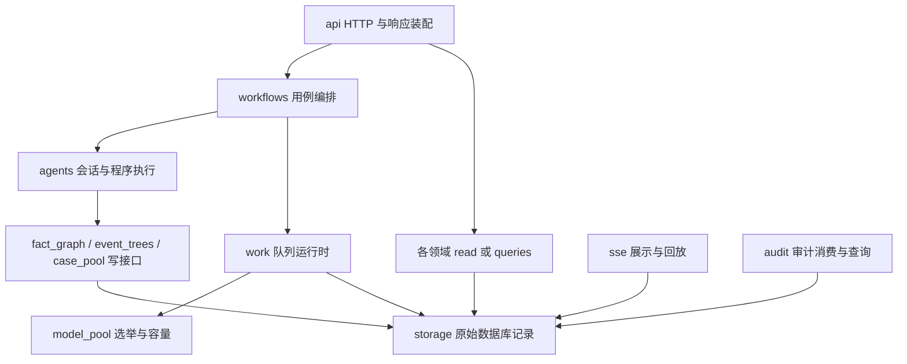

# 模块依赖与职责重划分实施结果

本次在基线 `0ff05bdea28d2324461c4cfe3bfbd7d3e532f968` 上实施既定方案。`src` 从 18 个顶层包调整为 21 个顶层包，新增 `text_processing`、`audit`、`diagnosis`，当前包内有 361 个 Python 文件。没有新增统一 core/common/services 包。

## 当前模块及实际直接依赖

下表由当前源码 AST 解析生成，包含相对导入、函数内导入和可解析动态导入。类型导入单列说明；白名单是准入上限，实际依赖以此表为准。

| 模块 | 职责 | 实际直接依赖 |
|---|---|---|
| `api` | HTTP 请求、响应模型、序列化、异常状态码映射与启动装配；命令交给 workflows，查询调用各领域 read/queries | `audit`、`case_pool`、`config`、`diagnosis`、`event_trees`、`fact_graph`、`linguistic`、`metrics`、`sse`、`storage`、`topic`、`work`、`workflows` |
| `workflows` | 小说、任务、run 生命周期与分析阶段编排；准备角色输入、推进阶段和进度；不拥有领域写规则 | `agents`、`audit`、`config`、`diagnosis`、`embedding`、`event_bus`、`fact_graph`、`lexicons`、`linguistic`、`metrics`、`model_pool`、`sse`、`storage`、`text_processing`、`topic`、`utils`、`work` |
| `agents` | 模型会话、流式请求、程序与构造器执行、工具适配、本 work 状态与产出；使用领域契约 | `audit`、`case_pool`、`config`、`diagnosis`、`embedding`、`event_bus`、`event_trees`、`fact_graph`、`model_pool`、`sse`、`storage`、`utils`、`work` |
| `work` | Role/WorkReceipt、角色完成策略、队列派发、取消、保存确认、恢复及任务产物清理 | `config`、`event_bus`、`model_pool`、`storage`、`utils` |
| `model_pool` | 自身选举契约、容量租约、模型选择、失败权重、重派预算与退避 | `config`、`event_bus`、`utils`；仅类型：`embedding` |
| `embedding` | 向量请求、批处理、查询指令与用量回调 | `config` |
| `fact_graph` | 实体身份、关系规则、图谱写入、人物引用判断与只读受控图谱视图 | `storage`、`utils` |
| `event_trees` | 事件树内因果、排序与读投影、伏笔状态、照应连接和回收预期；单向消费 fact_graph 身份契约 | `fact_graph`、`storage`、`utils` |
| `case_pool` | 案例登记、认领、交付、办理状态和案例查询；保留 push_case(description)/promise_case(case_id) | `storage`、`utils` |
| `metrics` | 纯指标计算及所属指标 queries；SQL 取数、缓存与结果保存不进入计算子模块 | `config`、`event_trees`、`fact_graph`、`lexicons`、`storage`、`text_processing`、`work` |
| `linguistic` | LTP、语言结构、情绪事件、Word2Vec、所属语言结构读聚合与完成判定 | `config`、`metrics`、`storage`、`text_processing`、`work` |
| `topic` | 主题训练/推断、模型产物加载、主题标签/词表与主题读聚合、完成判定 | `config`、`lexicons`、`storage` |
| `storage` | ORM、连接、数据库结构检查、SQL 与原始记录读写；不依赖领域服务、embedding 或训练模块 | `config`、`utils` |
| `sse` | 展示状态、消息持久化适配、发送、游标过滤、断线回放与重跑显示隔离；不依赖 HTTP 框架 | `event_bus`、`storage` |
| `lexicons` | 词表常量、解析、加载与注册 | 无 |
| `config` | 配置、环境凭据、配置校验、日志及模型路径；不提供领域标签词表或业务完成判定 | 无 |
| `utils` | 摘要、取消检查、token 计数与无业务语义的解析等少量通用能力 | 无 |
| `event_bus` | 消息投递、订阅、定向请求与回执；无业务模块依赖 | 无 |
| `text_processing` | 文档读取、清洗、章节解析、段落切分、分词与文本位置模型；不依赖数据库或执行层 | `lexicons` |
| `audit` | 审计消息消费、去重、持久化、屏障及用量查询；不计算全书指标或参与 work 的业务保存事务 | `event_bus`、`storage` |
| `diagnosis` | 完整诊断契约、修订、标签词表、归一与只读查询；模型会话和提示词仍在 agents | `config`、`event_trees`、`fact_graph`、`metrics`、`storage`、`topic`、`utils` |

## 主干方向与查询边界



图示只表达主干，不代表所有白名单边。API 仍可读取原始小说/run 元数据并装配 HTTP 生命周期；领域写入由 workflows 和 agents 驱动。`event_trees → fact_graph` 的实体身份与参与者契约依赖保留，反向依赖由检查禁止。

领域读接口分别位于 `fact_graph/read/`、`event_trees/read/`、`case_pool/read.py`、`metrics/queries/`、`linguistic/queries.py`、`topic/queries.py`、`diagnosis/read.py`、`work/queries.py`、`audit/queries.py`。它们返回领域 DTO 或明确数据结构；HTTP 响应模型留在 `api/models/responses/`。

## 已完成的边界调整

### 存储、领域和计算

- 图谱归并、人物引用判断与图谱视图迁入 `fact_graph/read/`；事件投影、排序、伏笔与回收预期迁入 `event_trees/read/`
- `AnnotationRepository`、`EventForestRecords`、`OutboxRecords` 和诊断仓储提供原始记录；角色完成规则位于 `work/policy.py` 和 `work/queries.py`
- 预处理完成判定位于 `workflows/preprocess_readiness.py`；语言、主题、聚合和诊断的完成判定分别归所属领域，仓储不解释阶段是否业务完成
- `metrics/aggregate` 通过 `AggregateInputs` 和显式参数消费输入数据；SQL/缓存由 `metrics/queries` 负责。全书统计的纯计算位于 `metrics/curve_metrics.py`，取数保存位于 `metrics/queries/global_stats.py`，由聚合阶段调用
- 主题、语言结构和诊断读聚合分归 `topic`、`linguistic`、`diagnosis`，没有建立统一结果服务
- 原文混合检索及当前 work 的查询授权位于 `agents/annotation/text_search.py`、`queries.py`；关键词与向量 SQL 留在 storage
- 文本位置、章节解析和分词归 `text_processing`；词表解析和分类常量归 `lexicons`；模型路径归 `config/paths.py`。旧文本规范化常量和反向导出已清理
- 小说上传、登记、删除的协调位于 `workflows/novels.py`，业务异常由 workflows 定义，由 API 映射状态码

### 队列、选举、审计与展示

- `ChapterWorkerPool` 位于 `work/chapter_pool.py`；角色输入准备与阶段推进继续留在 workflows
- 模型池只消费冻结的 `SelectionRequest(run_id, work_id)`，返回 `SelectionResult`；不读取正文、角色或完整 `WorkReceipt`
- 队列保存原 work，并在容量选举结果返回后组装执行信封；选举附加字段仍排除在业务输入之外。模型池继续独占租约、容量、预算与退避
- 阶段上下文与进度位于 `workflows/progress.py`，阶段百分比从配置的 progress 设置读取，移除重复百分比表
- SSE HTTP 端点位于 `api/routes/sse.py`；`sse/state.py` 和 `sse/persistence.py` 拥有展示作用域、当前调用、重跑隔离与持久回放规则；storage 只做原始 outbox 记录写入、run 定位与游标分配
- 审计消费/去重/屏障/用量读查询归 audit，模型调用观察器仍归 agents；全书指标保存不再由审计消费者驱动

### agent 状态和领域贡献

账本明确拥有四个工作状态，不使用通用代理或动态属性兜底：

| 状态 | 实际归属 | 内容 |
|---|---|---|
| 实体关系绑定 | `agents/annotation/state_entities.py` | 局部实体、关系、EL 绑定、实体目录与事实图工作状态 |
| 事件绑定 | `agents/annotation/state_events.py` | 事件树、待完成子事件、参与者与观察记录 |
| 对话证据 | `agents/annotation/state_dialogue.py` | 对话候选、已写对话、读取授权、文本引用与证据锚点 |
| 章级指标 | `agents/annotation/state_metrics.py` | 指标和已绑定标签载荷 |

`AnnotationToolLedger` 只协调角色权限、局部引用、记录键、快照恢复和 finish。原有 program、构造器、solo/三角色、批事件、部分成功回执和保存链路保留。`BoundChapterAnnotation` 归 `agents/annotation/output_models.py`；程序护栏与事件提交适配归 agent 程序面。

三个领域保存入口分别消费 `FactContribution`、`EventContribution`、`CaseContribution`，不通过 `Any execution` 访问账本。贡献冻结嵌套证据和 JSON 快照，解码生成新的可变容器；冻结后修改账本或调用方载荷不会改变待保存贡献。原事务顺序、锁、保存确认和恢复语义继续保留。

限额、IR 常量、流式错误、审计流类型与计时器通过实际定义模块导入；测试使用显式注入。`fact_graph/schema.py` 不反向 re-export inputs/outputs，旧 program/tools 门面不再回指其消费者。

## 防止依赖退化的检查

`tests/test_api_work_boundary.py` 有 15 个架构检查；AST 实现在 `tests/support/module_dependencies.py`。检查覆盖相对与函数内导入、可解析动态导入、导出链实际定义和 TYPE_CHECKING 区分，分别验证顶层包及文件级运行时依赖无环。

准入同时约束 21 个包白名单、API 读接口前缀、HTTP 框架仅归 API、纯计算不读数据库/网络、模型池不消费业务信封、冻结领域保存契约、四类状态所有权、阶段完成判定和 SSE 展示规则不归 storage、config 不导出领域词表，以及 deprecated 忽略/无跟踪/无导入。新增包、越界导入或旧门面反向导出会使测试失败。

## 归档与恢复

生产侧共 44 个符号本地归档；测试侧有 36 份片段，其中 4 份是混合测试原始副本，活动断言仍留在测试中。`chunk_documents_with_chapters` 复核后确认活跃，保留在 `text_processing/paragraphs.py`，不计入退役清单。

`deprecated/` 的实现和本地清单均被原有忽略规则排除，没有修改 deprecated 忽略规则，没有强制添加。逐项原路径、符号、依据、替代入口、基线提交与恢复方式见 [module-archive.md](module-archive.md)。活动代码、测试和导出工具不导入归档目录；对归档实现调用的辅助函数又做了一次级联孤儿检查。

## 验证结果与范围

| 检查 | 结果 |
|---|---|
| 重构前完整后端基线 | 1801 passed；91.38% 覆盖率；pytest 99.59 秒，总壁钟 105.39 秒 |
| 最终完整后端回归 | 1765 passed，13 warnings；91.74% 覆盖率；pytest 117.69 秒，总壁钟 125.92 秒，满足 5 分钟冷启动限时 |
| 分批提交前完整后端复核 | 1765 passed，13 warnings；91.74% 覆盖率；pytest 149.78 秒，总壁钟 157.25 秒，满足 5 分钟冷启动限时 |
| Ruff / mypy | `ruff check src tests` 通过；`mypy src` 通过，检查 362 个源文件 |
| 架构与契约 | 15 个 AST 架构检查通过；顶层和文件级运行时依赖无环；冻结贡献及账本快照/恢复检查通过 |
| HTTP 合同 | 完整 OpenAPI JSON 与重构前快照完全相等，包含 paths、schemas 与描述 |
| 实际 API / JSON 导出 | 独立测试 schema，10 个原查询入口及图谱组合/指标两个补验入口均返回 200；5 章完成状态、4 事件节点/2 棵树、焦点人物及导出数据断言通过 |
| 实际前端 | 仪表盘、角色、主题、诊断、时间轴事件详情、事件树与原文阅读器均通过真实浏览器验收；图谱节点可见、放大、搜索高亮与关系演变补验通过 |
| SSE | 两次刷新回放均只保留已保存 work 与当前调用输出；旧调用/旧终态隔离；游标递增；Last-Event-ID 续传通过 |
| 离线报告 | 使用同一固定数据，实际生成并浏览自包含 HTML；主题标签与诊断正文显示，无外部资源请求或脚本错误；报告专项 94 passed，pytest 16.79 秒，总壁钟 21.75 秒 |
| Git | deprecated 无跟踪文件；忽略规则未修改；活动目录无归档导入 |

最终测试数量变化来自退役专属测试移除及架构/贡献测试增加；没有为提高覆盖率删掉活动能力的失败断言。13 个全量告警是既有 Starlette 422 常量弃用告警，基线已有。报告专项 94 项也被最后一次全量回归覆盖。

固定数据验收运行真实 FastAPI 路由、仓储、领域查询、SSE 持久化和前端。临时服务替换启动生命周期，以避免生产结构升级或恢复运行；使用独立测试 schema 并在验收后清理。浏览器记录限定于已执行的页面和交互，不代表全站交互全覆盖。主题模型是本地小样本训练，没有付费模型请求，没有生产数据库或结构迁移。运行态错误、迟到调用、重复消息、部分失败、保存失败、确认不明、取消/恢复、容量归还、重派预算和审计去重由保留的相关测试及全量回归覆盖。

浏览器补验同时发现有效空人物关系图触发 HITS 的 ARPACK 异常。纯图算法现在在没有有效人物关系时保留快照和 PageRank，HITS/模块度回显不可计算原因，非空关系算法保持原计算。两种读取端点的相关 35 项回归通过；这项行为修复有专门 API 回归，纳入最终全量测试。

已有本地忽略的 `tools/report_exporter/` 同步适配领域查询、仓储原始读取和溯源声明。浏览器补验发现模板将字典 `topic_labels` 当列表处理，修复为当前字典契约的值列表，并补实际 JavaScript 执行回归；该本地工具原有忽略规则保持不变。

提交整理移除 197 个仅编码或换行变化的文件噪声，保留全部实质改动；代码终态通过逐文件摘要核对，与本次提交前完整回归时一致。首批文本迁移索引快照通过 API 导入、241 项直接相关测试及 Ruff；主体架构索引快照通过完整 OpenAPI 一致性、99 项关键回归（含 15 项 AST 护栏）及 Ruff。两次索引检查总壁钟分别为 11.48 秒和 22.05 秒，计时包含模块导入与 pytest，均低于 30 秒。提交前项目入口的 Ruff 和 mypy 也通过。

复查命令：

```powershell
powershell -ExecutionPolicy Bypass -File scripts/dev.ps1 test tests/test_api_work_boundary.py -q --no-cov
.venv/Scripts/python.exe -m ruff check src tests
.venv/Scripts/python.exe -m mypy src
powershell -ExecutionPolicy Bypass -File scripts/dev.ps1 test
powershell -ExecutionPolicy Bypass -File scripts/dev.ps1 test tests/report -q --no-cov
git diff --check
git ls-files -- deprecated
git check-ignore deprecated/architecture/probe.py
```

恢复应按文本与契约、领域查询/计算、队列与审计/SSE、账本/贡献、退役清理几个风险边界配套回退。先从基线提取待恢复符号到临时文件，复核其实际调用与依赖，再恢复对应实现和测试并运行相关检查；不整文件覆盖当前工作区，不重建旧兼容入口。

本次在 `codex/queue-agent-book-state` 按四批提交：文本/词表/路径迁移，主体架构与同步 AST 护栏及退役清理，空关系图修复，架构与归档恢复文档。跨模块契约、查询和消费者同步进入主体批次，以保持中间提交可导入并通过相应检查。没有合并或推送，`deprecated/` 始终不进入索引或提交。


## 独立审核修复

四状态分别提供 `fact_views()`，账本仅组装审计事实，恢复指标、事件、对话和人物观察的完整摘要。回归覆盖真实工具写入、快照恢复和下一模型回合的实际审计持久化。阶段百分比由 `workflows.progress.stage_progress_percent` 统一计算，保存回调把值交给 agent 展示；默认与自定义阶段区间均有实际保存路径测试。

关系稳定身份归 `fact_graph.identity`，端点排序和 UUID 输入完全保持；仓储旧 identity 文件因剩余无调用规范化函数归档而移除。API 护栏检查 re-export 的实际定义，指标计算护栏递归检查查询、辅助模块通往数据库和网络的依赖，并以三项负例/类型引用回归防止漏检。AST 护栏从 15 项增至 18 项。

`scripts/tools/compare_module_results.py` 提取 B0 源码到忽略的临时目录，在当前代码生成的同一份隔离 PostgreSQL 记录和模型文件上分别运行真实 FastAPI 路由，比较 11 个完整响应与实际 JSON 导出。只规范化 `results.file_path` 和 `export.generated_at`，其余字段及数组顺序全部相等；不进入生产启动生命周期，不做生产迁移或付费模型请求，独立 schema 在 finally 中清理。

版本化 `tests/api/fixtures/module_results_baseline.json` 记录 B0 提交与全部响应。重新构造数据的回归中，仅将 `graph.edges` 与 `export.character_relations` 两个无排序契约的关系集合按完整内容规范化，避免依赖 PostgreSQL 物理构造顺序；事件、时间轴、章节、主题等业务数组保留原序，身份、指标、标签和缺失字段继续完整比较。固定 UUID 与训练种子确保数据可复现；最终人物图采用三角关系，旧空图故障由既有专门回归覆盖。新增脚本仅增加自身 Git 白名单，deprecated 忽略规则未改。

审核修复验收：52 项相关回归通过，pytest 17.53 秒、总壁钟 21.37 秒；全量项目入口 `scripts/dev.ps1 test` 1772 passed、13 warnings，覆盖率 91.92%，pytest 117.88 秒、总壁钟 122.99 秒，满足 5 分钟冷启动限时。相关回归计时包含准备、模块导入和测试，保守总耗时低于 30 秒；未把这段计时声称为已分离的热启动耗时。Ruff（含新增对照脚本）与 mypy 通过，后者检查 362 个源文件。三个原审核代理独立只读复核均通过。

本轮运行实际 API 路由、真实审计保存与隔离数据库回归，未重新进行浏览器交互验收；此前浏览器与 SSE 证据的范围保持原记录。本次查询基线证明该固定输入的读侧和导出等价，不扩展为所有数据或真实模型执行等价。
